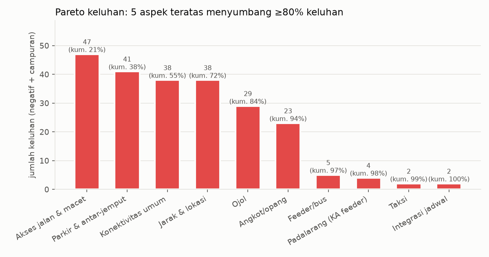
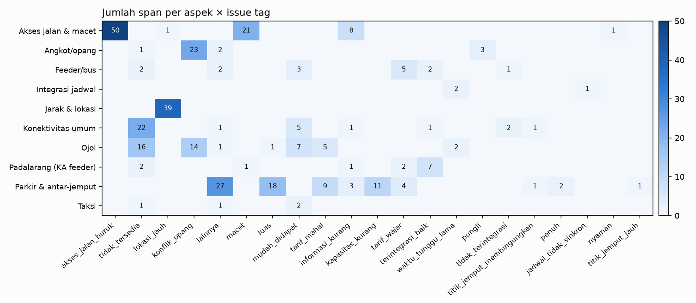
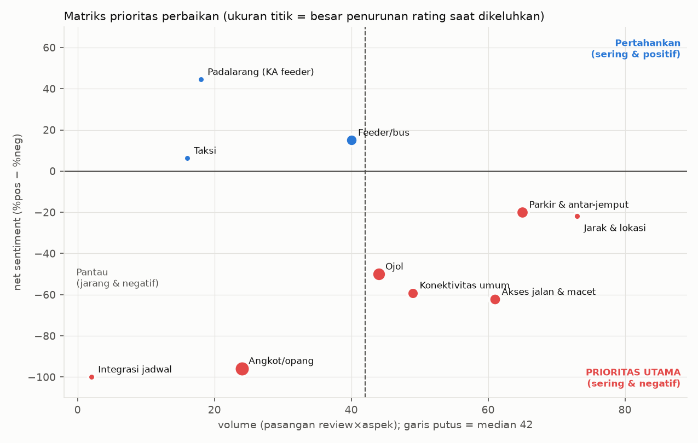
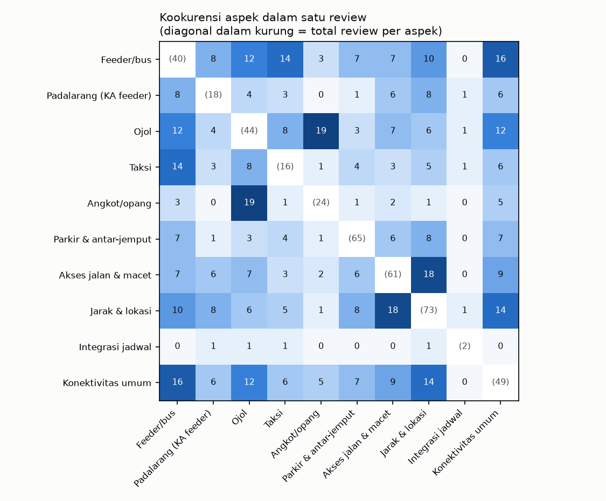

# Analisis lanjutan — ABSA konektivitas Stasiun Whoosh Tegalluar

> Turunan dari label final (LLM, tanpa validasi manusia; lihat evaluation.md). Semua tabel tersedia di `tables/*.csv` dan `whoosh_absa_hasil.xlsx`.

## E1. Jumlah sentimen (angka absolut)

Dasar: 673 review bertekstual → 234 relevan → 392 pasangan review×aspek → 447 span/kutipan.

### E1a. Per aspek (jumlah & persen)

| aspek | total | n_negatif | n_campuran | n_netral | n_positif | %_negatif | %_campuran | %_netral | %_positif | net | share_of_voice_% |
|---|---|---|---|---|---|---|---|---|---|---|---|
| Jarak & lokasi | 73 | 36 | 2 | 15 | 20 | 49.3 | 2.7 | 20.5 | 27.4 | -21.9 | 18.6 |
| Parkir & antar-jemput | 65 | 33 | 8 | 4 | 20 | 50.8 | 12.3 | 6.2 | 30.8 | -20.0 | 16.6 |
| Akses jalan & macet | 61 | 46 | 1 | 6 | 8 | 75.4 | 1.6 | 9.8 | 13.1 | -62.3 | 15.6 |
| Konektivitas umum | 49 | 38 | 0 | 2 | 9 | 77.6 | 0.0 | 4.1 | 18.4 | -59.2 | 12.5 |
| Ojol | 44 | 29 | 0 | 8 | 7 | 65.9 | 0.0 | 18.2 | 15.9 | -50.0 | 11.2 |
| Feeder/bus | 40 | 5 | 0 | 24 | 11 | 12.5 | 0.0 | 60.0 | 27.5 | 15.0 | 10.2 |
| Angkot/opang | 24 | 23 | 0 | 1 | 0 | 95.8 | 0.0 | 4.2 | 0.0 | -95.8 | 6.1 |
| Padalarang (KA feeder) | 18 | 4 | 0 | 2 | 12 | 22.2 | 0.0 | 11.1 | 66.7 | 44.4 | 4.6 |
| Taksi | 16 | 2 | 0 | 11 | 3 | 12.5 | 0.0 | 68.8 | 18.8 | 6.2 | 4.1 |
| Integrasi jadwal | 2 | 2 | 0 | 0 | 0 | 100.0 | 0.0 | 0.0 | 0.0 | -100.0 | 0.500 |
| SEMUA ASPEK | 392 | 218 | 11 | 73 | 90 | 55.6 | 2.8 | 18.6 | 23.0 | -32.7 | 100.0 |

*share of voice* = porsi aspek dari seluruh penyebutan aspek.

### E1b. Per tingkat analisis

| tingkat | total | negatif | campuran | netral | positif |
|---|---|---|---|---|---|
| Span (setiap kutipan) | 447 | 265 | 7 | 79 | 96 |
| Review × aspek | 392 | 218 | 11 | 73 | 90 |

### E1c. Polaritas per review (gabungan semua aspek dalam satu review)

| polaritas review | jumlah review | % dari review relevan |
|---|---|---|
| negatif saja | 135 | 57.7 |
| positif saja | 50 | 21.4 |
| campuran (ada positif & negatif) | 28 | 12.0 |
| netral saja | 21 | 9.0 |

## E2. Pareto keluhan

Total keluhan (review×aspek negatif/campuran): 229. **5 aspek teratas menyumbang ≥ 80%** keluhan.

| aspek | keluhan | %_dari_total_keluhan | kumulatif_% |
|---|---|---|---|
| Akses jalan & macet | 47 | 20.5 | 20.5 |
| Parkir & antar-jemput | 41 | 17.9 | 38.4 |
| Konektivitas umum | 38 | 16.6 | 55.0 |
| Jarak & lokasi | 38 | 16.6 | 71.6 |
| Ojol | 29 | 12.7 | 84.3 |
| Angkot/opang | 23 | 10.0 | 94.3 |
| Feeder/bus | 5 | 2.2 | 96.5 |
| Padalarang (KA feeder) | 4 | 1.7 | 98.3 |
| Taksi | 2 | 0.900 | 99.1 |
| Integrasi jadwal | 2 | 0.900 | 100.0 |

## E3. Issue tags

### E3a. Jumlah per tag × sentimen (level span)

| tag | negatif | campuran | netral | positif | total |
|---|---|---|---|---|---|
| akses_jalan_buruk | 50 | 0 | 0 | 0 | 50 |
| tidak_tersedia | 44 | 0 | 0 | 0 | 44 |
| lokasi_jauh | 39 | 1 | 0 | 0 | 40 |
| konflik_opang | 37 | 0 | 0 | 0 | 37 |
| lainnya | 30 | 4 | 0 | 0 | 34 |
| macet | 21 | 0 | 1 | 0 | 22 |
| luas | 0 | 4 | 0 | 15 | 19 |
| mudah_didapat | 0 | 0 | 0 | 17 | 17 |
| tarif_mahal | 14 | 0 | 0 | 0 | 14 |
| informasi_kurang | 11 | 1 | 1 | 0 | 13 |
| kapasitas_kurang | 10 | 1 | 0 | 0 | 11 |
| tarif_wajar | 0 | 1 | 0 | 10 | 11 |
| terintegrasi_baik | 0 | 0 | 0 | 10 | 10 |
| waktu_tunggu_lama | 4 | 0 | 0 | 0 | 4 |
| pungli | 3 | 0 | 0 | 0 | 3 |
| tidak_terintegrasi | 3 | 0 | 0 | 0 | 3 |
| titik_jemput_membingungkan | 2 | 0 | 0 | 0 | 2 |
| penuh | 2 | 0 | 0 | 0 | 2 |
| jadwal_tidak_sinkron | 1 | 0 | 0 | 0 | 1 |
| nyaman | 0 | 0 | 0 | 1 | 1 |
| titik_jemput_jauh | 1 | 0 | 0 | 0 | 1 |

### E3b. Matriks aspek × tag

Tabel lengkap: `tables/E3b_matriks_aspek_x_tag.csv`.

## E4. Matriks prioritas perbaikan

Sumbu x = seberapa sering dibahas; sumbu y = net sentiment; *dampak_rating_keluhan* = selisih rata-rata bintang review yang mengeluhkan aspek tsb vs sisanya (OLS univariat, asosiasi).

| aspek | total | n_negatif | net | dampak_rating_keluhan | kuadran |
|---|---|---|---|---|---|
| Taksi | 16 | 2 | 6.2 | – | Kekuatan minor (jarang & positif) |
| Feeder/bus | 40 | 5 | 15.0 | -0.970 | Kekuatan minor (jarang & positif) |
| Padalarang (KA feeder) | 18 | 4 | 44.4 | – | Kekuatan minor (jarang & positif) |
| Akses jalan & macet | 61 | 46 | -62.3 | -1.0 | PRIORITAS UTAMA (sering & negatif) |
| Konektivitas umum | 49 | 38 | -59.2 | -0.910 | PRIORITAS UTAMA (sering & negatif) |
| Ojol | 44 | 29 | -50.0 | -1.6 | PRIORITAS UTAMA (sering & negatif) |
| Jarak & lokasi | 73 | 36 | -21.9 | -0.020 | PRIORITAS UTAMA (sering & negatif) |
| Parkir & antar-jemput | 65 | 33 | -20.0 | -1.2 | PRIORITAS UTAMA (sering & negatif) |
| Integrasi jadwal | 2 | 2 | -100.0 | – | Pantau (jarang & negatif) |
| Angkot/opang | 24 | 23 | -95.8 | -2.0 | Pantau (jarang & negatif) |

## E5. Kookurensi aspek (dibahas dalam review yang sama)

| aspek 1 | aspek 2 | review (semua sentimen) | review (keduanya dikeluhkan) |
|---|---|---|---|
| Angkot/opang | Ojol | 19 | 18 |
| Akses jalan & macet | Jarak & lokasi | 18 | 10 |
| Feeder/bus | Konektivitas umum | 16 | 3 |
| Feeder/bus | Taksi | 14 | 1 |
| Jarak & lokasi | Konektivitas umum | 14 | 5 |
| Konektivitas umum | Ojol | 12 | 8 |
| Feeder/bus | Ojol | 12 | 1 |
| Feeder/bus | Jarak & lokasi | 10 | 0 |
| Akses jalan & macet | Konektivitas umum | 9 | 7 |
| Feeder/bus | Padalarang (KA feeder) | 8 | 0 |
| Jarak & lokasi | Padalarang (KA feeder) | 8 | 1 |
| Ojol | Taksi | 8 | 0 |
| Jarak & lokasi | Parkir & antar-jemput | 8 | 2 |
| Akses jalan & macet | Feeder/bus | 7 | 1 |
| Akses jalan & macet | Ojol | 7 | 4 |

## E6. Rating

### E6a. Rating per aspek × sentimen

| category | sentiment | n | rata2 | median | 1★ | 2★ | 3★ | 4★ | 5★ |
|---|---|---|---|---|---|---|---|---|---|
| Akses jalan & macet | negatif | 46 | 3.4 | 4.0 | 8 | 5 | 7 | 13 | 13 |
| Akses jalan & macet | netral | 6 | 4.5 | 4.5 | 0 | 0 | 0 | 3 | 3 |
| Akses jalan & macet | positif | 8 | 4.8 | 5.0 | 0 | 0 | 0 | 2 | 6 |
| Angkot/opang | negatif | 23 | 2.4 | 2.0 | 9 | 5 | 2 | 5 | 2 |
| Angkot/opang | netral | 1 | 2.0 | 2.0 | 0 | 1 | 0 | 0 | 0 |
| Feeder/bus | negatif | 5 | 3.4 | 4.0 | 1 | 1 | 0 | 1 | 2 |
| Feeder/bus | netral | 24 | 4.6 | 5.0 | 0 | 1 | 1 | 5 | 17 |
| Feeder/bus | positif | 11 | 4.9 | 5.0 | 0 | 0 | 0 | 1 | 10 |
| Integrasi jadwal | negatif | 2 | 3.0 | 3.0 | 0 | 1 | 0 | 1 | 0 |
| Jarak & lokasi | negatif | 36 | 4.3 | 5.0 | 2 | 0 | 2 | 12 | 20 |
| Jarak & lokasi | netral | 15 | 4.8 | 5.0 | 0 | 0 | 0 | 3 | 12 |
| Jarak & lokasi | positif | 20 | 4.8 | 5.0 | 0 | 0 | 0 | 3 | 17 |
| Konektivitas umum | negatif | 38 | 3.5 | 4.0 | 6 | 3 | 6 | 12 | 11 |
| Konektivitas umum | netral | 2 | 5.0 | 5.0 | 0 | 0 | 0 | 0 | 2 |
| Konektivitas umum | positif | 9 | 4.9 | 5.0 | 0 | 0 | 0 | 1 | 8 |
| Ojol | negatif | 29 | 2.9 | 3.0 | 7 | 6 | 5 | 6 | 5 |
| Ojol | netral | 8 | 4.4 | 5.0 | 0 | 1 | 0 | 2 | 5 |
| Ojol | positif | 7 | 4.9 | 5.0 | 0 | 0 | 0 | 1 | 6 |
| Padalarang (KA feeder) | negatif | 4 | 4.0 | 4.5 | 0 | 1 | 0 | 1 | 2 |
| Padalarang (KA feeder) | netral | 2 | 5.0 | 5.0 | 0 | 0 | 0 | 0 | 2 |
| Padalarang (KA feeder) | positif | 12 | 4.3 | 5.0 | 1 | 0 | 1 | 2 | 8 |
| Parkir & antar-jemput | negatif | 33 | 3.1 | 3.0 | 11 | 2 | 4 | 6 | 10 |
| Parkir & antar-jemput | netral | 4 | 4.5 | 4.5 | 0 | 0 | 0 | 2 | 2 |
| Parkir & antar-jemput | positif | 20 | 4.7 | 5.0 | 0 | 0 | 0 | 6 | 14 |
| Taksi | negatif | 2 | 5.0 | 5.0 | 0 | 0 | 0 | 0 | 2 |
| Taksi | netral | 11 | 4.5 | 5.0 | 0 | 1 | 0 | 3 | 7 |
| Taksi | positif | 3 | 5.0 | 5.0 | 0 | 0 | 0 | 0 | 3 |

### E6b. Apa isi review bintang 1–2? (71 review bertekstual; 46 = 65% membahas konektivitas)

| category | review 1-2★ yang mengeluhkan | % dari review 1-2★ bertekstual |
|---|---|---|
| Angkot/opang | 14 | 19.7 |
| Parkir & antar-jemput | 14 | 19.7 |
| Akses jalan & macet | 13 | 18.3 |
| Ojol | 13 | 18.3 |
| Konektivitas umum | 9 | 12.7 |
| Feeder/bus | 2 | 2.8 |
| Jarak & lokasi | 2 | 2.8 |
| Integrasi jadwal | 1 | 1.4 |
| Padalarang (KA feeder) | 1 | 1.4 |

### E6c. Distribusi bintang (kelompok 'tidak relevan' hanya sebagai pembanding)

| kelompok | 1.0 | 2.0 | 3.0 | 4.0 | 5.0 |
|---|---|---|---|---|---|
| relevan konektivitas | 31 | 15 | 17 | 54 | 117 |
| tidak relevan | 24 | 1 | 9 | 58 | 347 |

## E7. Profil review relevan

- Rata-rata aspek per review relevan: 1.68
- Panjang teks median: relevan 156 karakter vs tidak relevan 46 karakter

| jumlah aspek dalam review | jumlah review | % |
|---|---|---|
| 1.0 | 141.0 | 60.3 |
| 2.0 | 51.0 | 21.8 |
| 3.0 | 24.0 | 10.3 |
| 4.0 | 15.0 | 6.4 |
| 5.0 | 2.0 | 0.900 |
| 7.0 | 1.0 | 0.400 |

## E8. Segmen: listing × aspek dan bahasa × aspek

Isi sel: jumlah review×aspek (persen keluhan).

### Listing

| listing | total | Akses jalan & macet | Angkot/opang | Feeder/bus | Integrasi jadwal | Jarak & lokasi | Konektivitas umum | Ojol | Padalarang (KA feeder) | Parkir & antar-jemput | Taksi |
|---|---|---|---|---|---|---|---|---|---|---|---|
| Stasiun Kereta Cepat Tegalluar | 253 | 35 (77% neg) | 23 (96% neg) | 29 (17% neg) | 1 (100% neg) | 36 (61% neg) | 37 (81% neg) | 37 (68% neg) | 10 (20% neg) | 34 (56% neg) | 11 (9% neg) |
| Kereta Cepat Whoosh Tegalluar | 92 | 16 (88% neg) | 1 (100% neg) | 5 (0% neg) | 1 (100% neg) | 24 (33% neg) | 9 (67% neg) | 7 (57% neg) | 6 (17% neg) | 20 (65% neg) | 3 (33% neg) |
| Tegalluar Summarecon | 30 | 8 (62% neg) | – | 3 (0% neg) | – | 10 (70% neg) | 3 (67% neg) | – | 2 (50% neg) | 4 (100% neg) | – |
| Stasiun KCJB Tegalluar | 10 | 1 (0% neg) | – | 3 (0% neg) | – | 2 (50% neg) | – | – | – | 2 (0% neg) | 2 (0% neg) |
| Parkir Timur Stasiun Kereta Cepat Tegalluar | 7 | 1 (100% neg) | – | – | – | 1 (0% neg) | – | – | – | 5 (100% neg) | – |

### Bahasa

| bahasa | total | Akses jalan & macet | Angkot/opang | Feeder/bus | Integrasi jadwal | Jarak & lokasi | Konektivitas umum | Ojol | Padalarang (KA feeder) | Parkir & antar-jemput | Taksi |
|---|---|---|---|---|---|---|---|---|---|---|---|
| id | 352 | 56 (79% neg) | 23 (96% neg) | 35 (14% neg) | 2 (100% neg) | 62 (52% neg) | 42 (79% neg) | 40 (68% neg) | 18 (22% neg) | 60 (60% neg) | 14 (14% neg) |
| en | 32 | 3 (67% neg) | 1 (100% neg) | 3 (0% neg) | – | 9 (44% neg) | 7 (71% neg) | 4 (50% neg) | – | 3 (100% neg) | 2 (0% neg) |
| ja | 6 | 2 (50% neg) | – | 1 (0% neg) | – | 2 (100% neg) | – | – | – | 1 (100% neg) | – |
| su | 1 | – | – | – | – | – | – | – | – | 1 (100% neg) | – |
| zh | 1 | – | – | 1 (0% neg) | – | – | – | – | – | – | – |

## E9. Pergeseran topik per periode

Isi sel: jumlah review×aspek (porsi dari seluruh penyebutan pada periode itu). Periode relatif karena tanggal Google hanya "x bulan/tahun lalu".

| aspek | ±2 tahun lalu | ±setahun lalu | ≤ 11 bulan terakhir |
|---|---|---|---|
| Akses jalan & macet | 34 (13.9%) | 8 (12.5%) | 19 (22.6%) |
| Angkot/opang | 24 (9.8%) | 0 (0.0%) | 0 (0.0%) |
| Feeder/bus | 30 (12.3%) | 4 (6.2%) | 6 (7.1%) |
| Integrasi jadwal | 1 (0.4%) | 1 (1.6%) | 0 (0.0%) |
| Jarak & lokasi | 37 (15.2%) | 10 (15.6%) | 26 (31.0%) |
| Konektivitas umum | 30 (12.3%) | 12 (18.8%) | 7 (8.3%) |
| Ojol | 39 (16.0%) | 2 (3.1%) | 3 (3.6%) |
| Padalarang (KA feeder) | 9 (3.7%) | 3 (4.7%) | 6 (7.1%) |
| Parkir & antar-jemput | 27 (11.1%) | 23 (35.9%) | 15 (17.9%) |
| Taksi | 13 (5.3%) | 1 (1.6%) | 2 (2.4%) |

| periode | review×aspek | %neg |
|---|---|---|
| ±2 tahun lalu | 244 | 59.8 |
| ±setahun lalu | 64 | 60.9 |
| ≤ 11 bulan terakhir | 84 | 52.4 |

## E10. Moda yang dibahas (proksi cara datang/pulang)

Bukan survei moda; hanya moda yang disebut pengulas.

| moda | review | % dari review relevan | positif | negatif | netral | campuran | net |
|---|---|---|---|---|---|---|---|
| Kendaraan pribadi/antar-jemput | 65 | 27.8 | 20 | 33 | 4 | 8 | -20.0 |
| Ojek/mobil online | 44 | 18.8 | 7 | 29 | 8 | 0 | -50.0 |
| Bus feeder/DAMRI/shuttle | 40 | 17.1 | 11 | 5 | 24 | 0 | 15.0 |
| Angkot/ojek pangkalan | 24 | 10.3 | 0 | 23 | 1 | 0 | -95.8 |
| KA feeder via Padalarang | 18 | 7.7 | 12 | 4 | 2 | 0 | 44.4 |
| Taksi | 16 | 6.8 | 3 | 2 | 11 | 0 | 6.2 |

## E11. Permintaan / saran perbaikan dari pengulas

Span yang mengandung kata permintaan (tolong, mohon, perlu, semoga, sebaiknya, ditambah, please, should, …): **30**. Deteksi berbasis kata kunci (perkiraan; bisa ada salah tangkap).

| category | permintaan |
|---|---|
| Akses jalan & macet | 8 |
| Konektivitas umum | 8 |
| Parkir & antar-jemput | 7 |
| Ojol | 3 |
| Feeder/bus | 2 |
| Jarak & lokasi | 1 |
| Padalarang (KA feeder) | 1 |

- **Akses jalan & macet**: "sekali aja ke sini kl jalan belum diperbaiki" · "Kcic tolong bikin akses yg bener." · "Lalu lintas dan jarak dari stasiun kereta lokal terdekat, yaitu Stasiun Cimekar,"
- **Feeder/bus**: "perlu ditambah alternatif moda transportasi lain seperti bus" · "Mohon diperbanyak lagi untuk angkutan fedeernya."
- **Jarak & lokasi**: "Lokasi trrlalu jauh,harusnya di kota"
- **Konektivitas umum**: "perlu di tingkatkan lagi sarana ke pusat kota bandung" · "hanya konektivitas saja yang perlu diperhatikan" · "Semoga kedepanya sistem transit ke transportasi lain diperbanyak lagi karena unt"
- **Ojol**: "sebaiknya hati-hati dengan tarif nembak dari supirnya" · "Grab? Should be removed." · "you need to wait 15-20min on app to get regular price, just to get cancelled"
- **Padalarang (KA feeder)**: "kalo bisa naik feeder gratis kenapa naik bis ya"
- **Parkir & antar-jemput**: "parkir untuk saat ini cukup tapi sepertinya perlu ditambah" · "sebaiknya untuk parkiran motor atau roda dua sebaiknya ada atap tertutup" · "mengenai parkiran mohon di kasih pembatas polisi tidur kotak buat ban"

## E12. Kata & frasa teratas dalam keluhan per aspek

| aspek | n keluhan | kata/frasa teratas |
|---|---|---|
| Feeder/bus | 5 | damri (2), puter (2) |
| Padalarang (KA feeder) | 4 | padalarang (3), smp (2) |
| Ojol | 32 | online (13), ojol (8), ojek (8), masuk (7), ojek online (6), penumpang (5), ambil (4), banyak (4), grab (4), gojek (3) |
| Taksi | 2 | puter (2) |
| Angkot/opang | 26 | ojek (16), pangkalan (11), ojek pangkalan (11), opang (7), preman (5), harus (3), penumpang (3), premanisme (2), taxi (2), umum (2) |
| Parkir & antar-jemput | 50 | parkir (26), parkiran (10), luas (7), parkirnya (6), motor (6), drop (5), mobil (5), gate (4), atap (4), off (4) |
| Akses jalan & macet | 70 | jalan (32), akses (26), macet (12), akses jalan (11), lewat (9), tol (8), susah (6), sempit (6), kecil (6), menuju (5) |
| Jarak & lokasi | 39 | jauh (24), kota (20), bandung (11), pusat (10), pusat kota (10), jauh pusat (8), kota bandung (7), lokasinya (7), mana (4), jauh mana (4) |
| Integrasi jadwal | 2 | jadual (2) |
| Konektivitas umum | 42 | akses (11), transportasi (11), umum (10), angkutan (5), perlu (5), transportasi umum (4), sulit (4), feeder (4), hanya (4), minim (4) |

## E13. Foto & likes

### E13a. Review relevan dengan/tanpa foto

| kelompok | review | pct_ada_keluhan | rata2_rating | rata2_likes |
|---|---|---|---|---|
| dengan foto | 107 | 64.5 | 4.4 | 0.480 |
| tanpa foto | 127 | 74.0 | 3.5 | 1.2 |

### E13b. Net sentiment berbobot likes (bobot = likes + 1)

| aspek | n | total likes | net biasa | net berbobot likes |
|---|---|---|---|---|
| Ojol | 44 | 140 | -50.0 | -83.2 |
| Angkot/opang | 24 | 128 | -95.8 | -98.7 |
| Konektivitas umum | 49 | 48 | -59.2 | -75.3 |
| Jarak & lokasi | 73 | 36 | -21.9 | -34.9 |
| Parkir & antar-jemput | 65 | 29 | -20.0 | -5.3 |
| Feeder/bus | 40 | 29 | 15.0 | 10.1 |
| Akses jalan & macet | 61 | 23 | -62.3 | -70.2 |
| Taksi | 16 | 11 | 6.2 | 3.7 |
| Padalarang (KA feeder) | 18 | 9 | 44.4 | 59.3 |
| Integrasi jadwal | 2 | 0 | -100.0 | -100.0 |

## E14. Balasan pengelola

Review dengan balasan pemilik/pengelola: **0 dari 1191** (0.0%) di kelima listing. Tidak ada satu pun keluhan konektivitas yang ditanggapi di Google Maps.

## E15. Katalog kutipan

447 kutipan (span) lengkap dengan aspek, sentimen, tag, rating, listing, periode, dan likes → sheet **E15 Katalog kutipan** di `whoosh_absa_hasil.xlsx` (bisa difilter).
