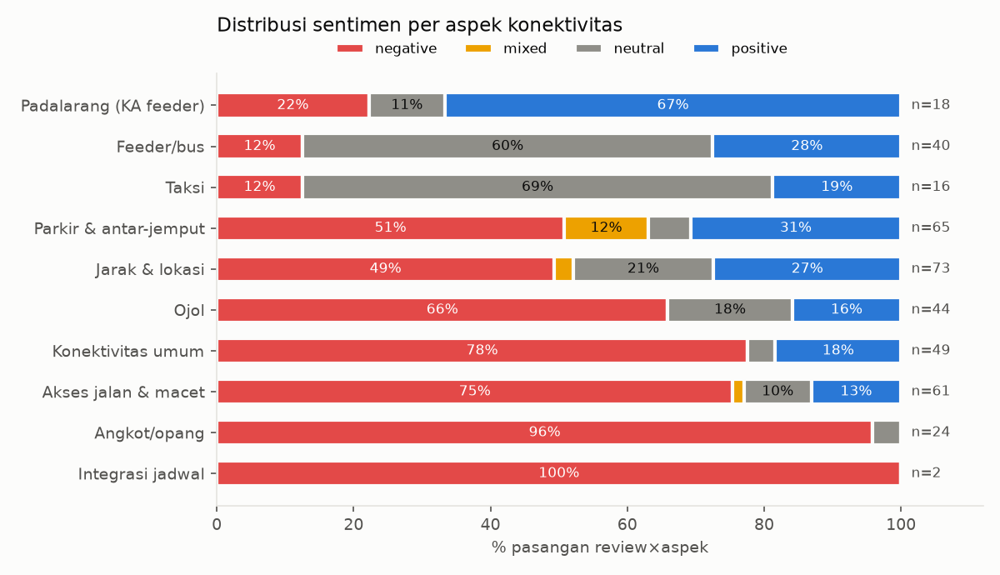
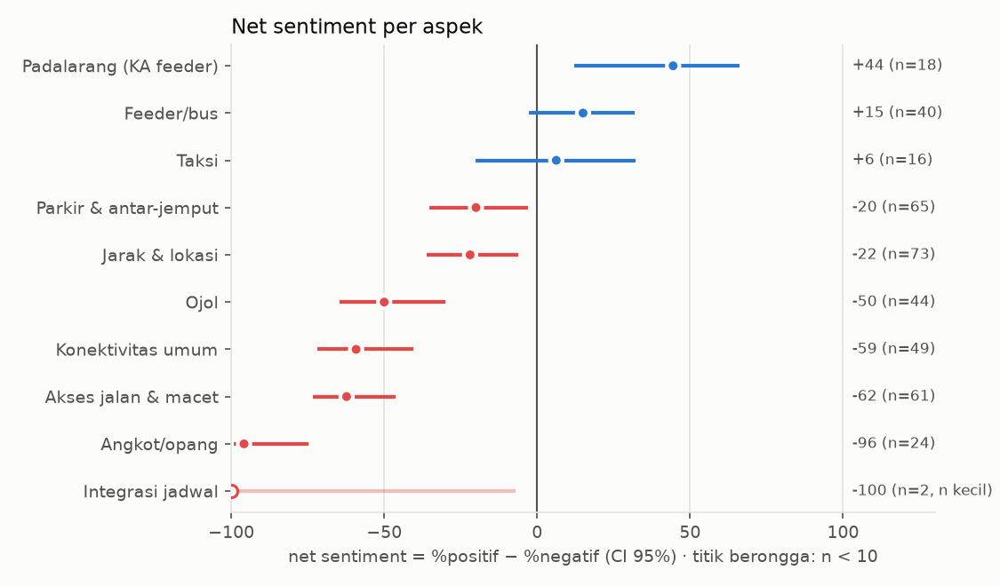
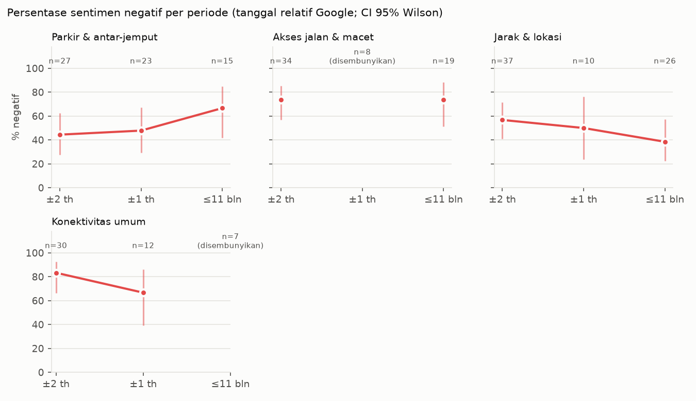
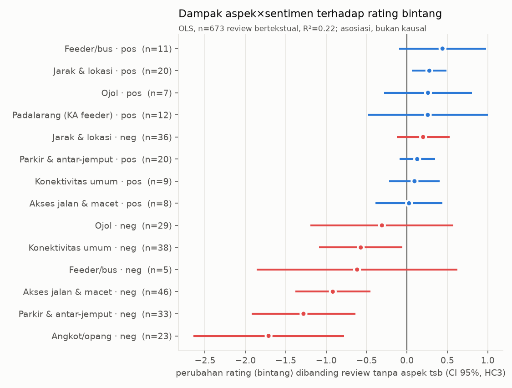

# Laporan analisis — ABSA konektivitas Stasiun Whoosh Tegalluar

> Label dibuat oleh LLM (Claude; 2 pass + adjudikasi) **tanpa validasi manusia** — lihat output/evaluation.md.

- Review total: 1191 (bertekstual 673, hanya rating 518)
- Review relevan konektivitas: 234 (34.8% dari bertekstual)
- Pasangan review×aspek: 392 · span: 447
- Rata-rata rating: relevan 3.90 · tidak relevan 4.60 · tanpa teks 4.80

## 1. Sentimen per aspek

Unit: pasangan review×aspek. Net = %positif − %negatif; CI 95% Wilson (selisih: MOVER).

| aspek | n | %neg | %mix | %neu | %pos | net | net_lo | net_hi |
|---|---|---|---|---|---|---|---|---|
| Integrasi jadwal | 2 | 100.0 | 0.0 | 0.0 | 0.0 | -100.0 | -100.0 | -7.0 |
| Angkot/opang | 24 | 95.8 | 0.0 | 4.2 | 0.0 | -95.8 | -99.3 | -74.6 |
| Akses jalan & macet | 61 | 75.4 | 1.6 | 9.8 | 13.1 | -62.3 | -73.4 | -46.2 |
| Konektivitas umum | 49 | 77.6 | 0.0 | 4.1 | 18.4 | -59.2 | -71.8 | -40.5 |
| Ojol | 44 | 65.9 | 0.0 | 18.2 | 15.9 | -50.0 | -64.6 | -30.0 |
| Jarak & lokasi | 73 | 49.3 | 2.7 | 20.5 | 27.4 | -21.9 | -36.2 | -6.1 |
| Parkir & antar-jemput | 65 | 50.8 | 12.3 | 6.2 | 30.8 | -20.0 | -35.4 | -3.1 |
| Taksi | 16 | 12.5 | 0.0 | 68.8 | 18.8 | 6.2 | -20.2 | 32.1 |
| Feeder/bus | 40 | 12.5 | 0.0 | 60.0 | 27.5 | 15.0 | -2.8 | 31.9 |
| Padalarang (KA feeder) | 18 | 22.2 | 0.0 | 11.1 | 66.7 | 44.4 | 12.0 | 66.0 |

## 2. Issue tags teratas per aspek

Dihitung per span. Contoh = evidence terpendek (kutipan asli, untuk verifikasi; di summary diparafrasekan).

### Feeder/bus
- **negative**: `lainnya` (2) — "jangan mau di paksa naik blue bird dan DAMRI di puter puter"; `tidak_tersedia` (2) — "Mohon diperbanyak lagi untuk angkutan fedeernya."; `tidak_terintegrasi` (1) — "kendaraan umum ada bis tp sangat tidak terintegrasi"
- **positive**: `tarif_wajar` (5) — "Bisa naik bis Damri dgn harga 15 rb saja."; `mudah_didapat` (3) — "有接駁巴士至萬隆市區，還算是方便"; `terintegrasi_baik` (2) — "sudah enak karena terintegrasi dengan layanan damri"

### Padalarang (KA feeder)
- **negative**: `tidak_tersedia` (2) — "Anda tidak mendapatkan akses ke kereta penghubung, itu sangat disayangkan!"; `macet` (1) — "tidak seperti stasiun kereta cepat Padalarang yg rawan kemacetan"
- **positive**: `terintegrasi_baik` (7) — "Tinggal turun disambut sama kereta feeder ke stasiun Bandung"; `tarif_wajar` (2) — "kalo bisa naik feeder gratis kenapa naik bis ya"

### Ojol
- **negative**: `tidak_tersedia` (16) — "masa ojol dilarang masuk"; `konflik_opang` (14) — "masa ojol dilarang masuk"; `tarif_mahal` (5) — "you will pay EXPENSIVE price to get a quick one"
- **positive**: `mudah_didapat` (7) — "24jam online tersedia"; `luas` (1) — "tempat menunggu mobil/kendaraan online cukup besar dan rapih"

### Taksi
- **negative**: `lainnya` (1) — "jangan mau di paksa naik blue bird dan DAMRI di puter puter"; `tidak_tersedia` (1) — "banyak taksi yang nolak"
- **positive**: `mudah_didapat` (2) — "taksi Bluebird"

### Angkot/opang
- **negative**: `konflik_opang` (23) — "bukan untuk opang saja"; `pungli` (3) — "OPANG NYA SUKA BERHENTIIN MINTAIN DUIT"; `lainnya` (2) — "sekarang malah nambah taxi asongan:("

### Parkir & antar-jemput
- **negative**: `lainnya` (23) — "mana gak ada atap"; `kapasitas_kurang` (10) — "parkiran kecil"; `tarif_mahal` (9) — "Parkiran mahal"
- **positive**: `luas` (14) — "Parkir luas"; `tarif_wajar` (3) — "Parkir nya juga gratis"

### Akses jalan & macet
- **negative**: `akses_jalan_buruk` (50) — "Tol belum di buka"; `macet` (20) — "Agak macet jalan kesana"; `informasi_kurang` (8) — "Rute nyasar2.."
- **positive**: `nyaman` (1) — "stasiun ini aksesnya sudah khusus ya, nyaman."

### Jarak & lokasi
- **negative**: `lokasi_jauh` (38) — "駅周辺には何もありません"

### Integrasi jadwal
- **negative**: `waktu_tunggu_lama` (2) — "Ada bus DAMRI juga jadual nya gak sesuai dg jadual whoosh jd kudu nunggu lama."; `jadwal_tidak_sinkron` (1) — "Ada bus DAMRI juga jadual nya gak sesuai dg jadual whoosh jd kudu nunggu lama."

### Konektivitas umum
- **negative**: `tidak_tersedia` (22) — "angkutan umum sulit"; `tidak_terintegrasi` (2) — "perlu diintegrasikan dg moda transum lebih banyak lg"; `lainnya` (1) — "Saran untuk yg berkendaraan umum, spare waktu 2 jam+ meskipun ini di dalam kota"
- **positive**: `mudah_didapat` (5) — "Aksesnya juga mudah kok"; `terintegrasi_baik` (1) — "terintegrasi dengan baik"

## 3. Tren %negatif per periode

Google hanya memberi tanggal relatif; 74% review relevan bertanggal "setahun lalu" atau "2 tahun lalu", sehingga tren bulanan/kuartalan tidak dapat dibuat. Dipakai tiga periode relatif (dari tanggal scraping 2026-09-25): ±2 tahun lalu (≈ Okt 2023 – awal 2025), ±setahun lalu (≈ 2025), ≤ 11 bulan terakhir. Sel dengan n < 10 disembunyikan.

config/events.csv memuat 16 peristiwa (2023-09-25 s.d. 2026-04-07). Karena tanggal review hanya relatif, peristiwa tidak digambar sebagai garis; persilangan peristiwa dengan periode review dibahas di output/linimasa_kebijakan.md.

| aspek | periode | n | %neg | lo | hi |
|---|---|---|---|---|---|
| Feeder/bus | ±2 tahun lalu | 30 | 16.7 | 7.3 | 33.6 |
| Feeder/bus | ±setahun lalu | 4 | – | – | – |
| Feeder/bus | ≤ 11 bulan terakhir | 6 | – | – | – |
| Padalarang (KA feeder) | ±2 tahun lalu | 9 | – | – | – |
| Padalarang (KA feeder) | ±setahun lalu | 3 | – | – | – |
| Padalarang (KA feeder) | ≤ 11 bulan terakhir | 6 | – | – | – |
| Ojol | ±2 tahun lalu | 39 | 66.7 | 51.0 | 79.4 |
| Ojol | ±setahun lalu | 2 | – | – | – |
| Ojol | ≤ 11 bulan terakhir | 3 | – | – | – |
| Taksi | ±2 tahun lalu | 13 | 7.7 | 1.4 | 33.3 |
| Taksi | ±setahun lalu | 1 | – | – | – |
| Taksi | ≤ 11 bulan terakhir | 2 | – | – | – |
| Angkot/opang | ±2 tahun lalu | 24 | 95.8 | 79.8 | 99.3 |
| Angkot/opang | ±setahun lalu | 0 | – | – | – |
| Angkot/opang | ≤ 11 bulan terakhir | 0 | – | – | – |
| Parkir & antar-jemput | ±2 tahun lalu | 27 | 44.4 | 27.6 | 62.7 |
| Parkir & antar-jemput | ±setahun lalu | 23 | 47.8 | 29.2 | 67.0 |
| Parkir & antar-jemput | ≤ 11 bulan terakhir | 15 | 66.7 | 41.7 | 84.8 |
| Akses jalan & macet | ±2 tahun lalu | 34 | 73.5 | 56.9 | 85.4 |
| Akses jalan & macet | ±setahun lalu | 8 | – | – | – |
| Akses jalan & macet | ≤ 11 bulan terakhir | 19 | 73.7 | 51.2 | 88.2 |
| Jarak & lokasi | ±2 tahun lalu | 37 | 56.8 | 40.9 | 71.3 |
| Jarak & lokasi | ±setahun lalu | 10 | 50.0 | 23.7 | 76.3 |
| Jarak & lokasi | ≤ 11 bulan terakhir | 26 | 38.5 | 22.4 | 57.5 |
| Integrasi jadwal | ±2 tahun lalu | 1 | – | – | – |
| Integrasi jadwal | ±setahun lalu | 1 | – | – | – |
| Integrasi jadwal | ≤ 11 bulan terakhir | 0 | – | – | – |
| Konektivitas umum | ±2 tahun lalu | 30 | 83.3 | 66.4 | 92.7 |
| Konektivitas umum | ±setahun lalu | 12 | 66.7 | 39.1 | 86.2 |
| Konektivitas umum | ≤ 11 bulan terakhir | 7 | – | – | – |

## 4. Dampak ke rating (OLS)

rating ~ dummy(aspek×sentimen), hanya dummy dengan ≥ 5 review; n = 673 review bertekstual; R² = 0.224; intersep = 4.55. SE robust HC3. Koefisien = selisih rata-rata bintang dibanding review tanpa aspek×sentimen tersebut (asosiasi, bukan kausal).

| dummy | koef | lo | hi | p | n |
|---|---|---|---|---|---|
| Angkot/opang · negative | -1.7 | -2.6 | -0.780 | 0.0 | 23.0 |
| Parkir & antar-jemput · negative | -1.3 | -1.9 | -0.637 | 0.0 | 33.0 |
| Akses jalan & macet · negative | -0.918 | -1.4 | -0.454 | 0.0 | 46.0 |
| Feeder/bus · negative | -0.617 | -1.9 | 0.627 | 0.331 | 5.0 |
| Konektivitas umum · negative | -0.572 | -1.1 | -0.056 | 0.030 | 38.0 |
| Ojol · negative | -0.310 | -1.2 | 0.575 | 0.493 | 29.0 |
| Akses jalan & macet · positive | 0.026 | -0.388 | 0.440 | 0.903 | 8.0 |
| Konektivitas umum · positive | 0.094 | -0.219 | 0.406 | 0.557 | 9.0 |
| Parkir & antar-jemput · positive | 0.127 | -0.092 | 0.346 | 0.256 | 20.0 |
| Jarak & lokasi · negative | 0.200 | -0.126 | 0.526 | 0.229 | 36.0 |
| Padalarang (KA feeder) · positive | 0.258 | -0.488 | 1.0 | 0.498 | 12.0 |
| Ojol · positive | 0.260 | -0.285 | 0.805 | 0.349 | 7.0 |
| Jarak & lokasi · positive | 0.277 | 0.064 | 0.490 | 0.011 | 20.0 |
| Feeder/bus · positive | 0.440 | -0.098 | 0.979 | 0.109 | 11.0 |

## 5. Perbandingan antar-listing dan antar-bahasa

### Listing

| Listing | review | relevan | %relevan | review×aspek | %neg | %neg_lo | %neg_hi | aspek terbanyak |
|---|---|---|---|---|---|---|---|---|
| Kereta Cepat Whoosh Tegalluar | 317 | 72 | 22.7 | 92 | 52.2 | 42.1 | 62.1 | Jarak & lokasi |
| Stasiun Kereta Cepat Tegalluar | 302 | 135 | 44.7 | 253 | 58.1 | 51.9 | 64.0 | Konektivitas umum |
| Tegalluar Summarecon | 32 | 17 | 53.1 | 30 | 60.0 | 42.3 | 75.4 | Jarak & lokasi |
| Stasiun KCJB Tegalluar | 12 | 4 | 33.3 | 10 | 10.0 | 1.8 | 40.4 | Feeder/bus |
| Parkir Timur Stasiun Kereta Cepat Tegalluar | 10 | 6 | 60.0 | 7 | 57.1 | 25.0 | 84.2 | Parkir & antar-jemput |

### Bahasa

| Bahasa | review | relevan | %relevan | review×aspek | %neg | %neg_lo | %neg_hi | aspek terbanyak |
|---|---|---|---|---|---|---|---|---|
| id | 587 | 209 | 35.6 | 352 | 55.7 | 50.5 | 60.8 | Jarak & lokasi |
| en | 73 | 19 | 26.0 | 32 | 53.1 | 36.4 | 69.1 | Jarak & lokasi |
| ja | 5 | 4 | 80.0 | 6 | 66.7 | 30.0 | 90.3 | Akses jalan & macet |
| und | 3 | 0 | 0.0 | 0 | – | – | – | – |
| ar | 2 | 0 | 0.0 | 0 | – | – | – | – |
| de | 1 | 0 | 0.0 | 0 | – | – | – | – |
| su | 1 | 1 | 100.0 | 1 | 100.0 | 20.7 | 100.0 | Parkir & antar-jemput |
| zh | 1 | 1 | 100.0 | 1 | 0.0 | 0.0 | 79.3 | Feeder/bus |

Listing/bahasa dengan review×aspek < 10 tidak layak dibandingkan (CI sangat lebar).

## 6. Tema di luar taksonomi (BERTopic)

Dokumen: 276 evidence unik (KONEKTIVITAS_UMUM + semua evidence negatif). Embedding: paraphrase-multilingual-mpnet-base-v2 (lokal, CPU).

Topik terbentuk: 14 (outlier: 35 dokumen).

| topik | n | kata kunci | aspek dominan (label) | contoh (dokumen representatif) |
|---|---|---|---|---|
| 0 | 42 | ojol, ojek, pangkalan, ojek pangkalan, masuk, sampe | Angkot/opang | dilarang preman berkedok ojek pangkalan |
| 1 | 37 | parkir, mobil, motor, jam, sebaiknya, biaya | Parkir & antar-jemput | penjaga parkir nya rada ngegas |
| 2 | 31 | umum, transportasi, stasiun, minim, kendaraan, sangat | Konektivitas umum | Akses transportasi umum masih sangat minim (kalau boleh dibilang tidak ada). |
| 3 | 23 | online, penumpang, waktu, driver, taksi, ambil | Ojol | susah pesen Gojek karna driver online gak dibolehin ambil dan anter ke daerah sini |
| 4 | 23 | kota, jauh, bandung, pusat, pusat kota, kota bandung | Jarak & lokasi | cukup jauh dari pusat kota bandung |
| 5 | 15 | macet, sempit, kemacetan, lalu, selalu, lalu lintas | Akses jalan & macet | Agak macet jalan kesana |
| 6 | 13 | akses, not, banget, aksesnya, belum, sulit | Konektivitas umum | Hanya aksesnya saja yang agak susah |
| 7 | 12 | jalan, kecil, jalan kecil, sempit, sampai, with | Akses jalan & macet | Mau masuk susah akses  jalan kecil diluar atu didalam area whooosh |
| 8 | 11 | stasiun, cimekar, akses stasiun, stasiun kereta, jarak, stasiun tegalluar | Konektivitas umum | Stasiun KA lokal terdekat dari lokasi adalah stasiun Cimekar. |
| 9 | 9 | akses, feeder, tolong, hanya, go, emang | Konektivitas umum | Kcic tolong bikin akses yg bener. |
| 10 | 7 | soekarno, tempatnya, whoosh, soekarno hatta, hatta, cibiru | Akses jalan & macet | sekarang malah nambah taxi asongan:( |
| 11 | 6 | station, dr, yg, stasiun, jauh, mana2 | Jarak & lokasi | Stasiun yg jauh. |
| 12 | 6 | akses jalan, jalan, cuma, akses, lewat, jelek | Akses jalan & macet | Tidak ada akses jalan kalau dari Ranca ekek..sementara ini jalan nya muter lewat sawah |
| 13 | 6 | jauh, meskipun, peradaban, mana2, mana, lumayan | Jarak & lokasi | Jauh dari peradaban hehe |

Interpretasi: topik yang aspek dominannya tersebar/tidak cocok dengan satu kode menandakan tema lintas-aspek.

## 7. Keluhan yang paling banyak disetujui (likes)

Total likes = jumlah likes review yang memuat keluhan (aspek×tag) tersebut. Likes di Google Maps kecil (maks 17); 79 dari 673 review punya ≥ 1 like.

| category | tag | review | total_likes | maks_likes |
|---|---|---|---|---|
| Angkot/opang | konflik_opang | 21 | 123 | 17 |
| Ojol | konflik_opang | 14 | 77 | 17 |
| Ojol | tidak_tersedia | 16 | 67 | 17 |
| Jarak & lokasi | lokasi_jauh | 37 | 25 | 9 |
| Akses jalan & macet | akses_jalan_buruk | 34 | 16 | 4 |
| Konektivitas umum | tidak_tersedia | 21 | 12 | 4 |
| Angkot/opang | pungli | 3 | 9 | 9 |
| Akses jalan & macet | macet | 20 | 8 | 3 |
| Akses jalan & macet | informasi_kurang | 6 | 7 | 4 |
| Angkot/opang | lainnya | 2 | 6 | 4 |
| Parkir & antar-jemput | lainnya | 22 | 5 | 2 |
| Parkir & antar-jemput | kapasitas_kurang | 10 | 4 | 4 |

Review negatif dengan likes terbanyak (evidence asli):

- 17 likes · Ojol — "berani membuat aturan sepihak untuk para ojol"
- 17 likes · Angkot/opang — "dilarang preman berkedok ojek pangkalan"
- 15 likes · Ojol — "ngelarang larang ojek online ambil penumpang"
- 15 likes · Konektivitas umum — "diberi kebijakan agar transportasi publik dipermudah dari dan ke stasiun ini"
- 12 likes · Ojol — "kasian buat yang online udah dicegatin diwanti2 aja"
- 9 likes · Angkot/opang — "preman berkedok ojek pangkalan  berperilaku kasar dan maksa buat ganti ojek mereka"
- 9 likes · Ojol — "susah pesen Gojek karna driver online gak dibolehin ambil dan anter ke daerah sini"
- 8 likes · Ojol — "Sayang sekali ojek online tidak bisa (tidak boleh )ambil penumpang dari stasiun !!"
