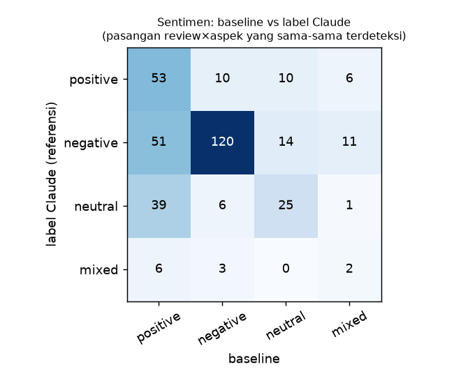

# Evaluasi — ABSA konektivitas Stasiun Whoosh Tegalluar

> **Label referensi dibuat oleh LLM (Claude: 2 pass independen + adjudikasi), bukan oleh manusia.** Peneliti memutuskan lanjut tanpa gold manusia. Semua angka di bawah menunjukkan **kesepakatan terhadap label LLM**, bukan akurasi terhadap kebenaran.

- Review berlabel: 673 · relevan: 234 · pasangan review×aspek: 392

## 1. Recall filter (Tahap 3)

- Review filter-out yang relevan: **0/142 = 0.0%** (batas 5%).
- Presisi filter (kandidat yang relevan): 234/531 = 44.1%.
- Recall filter (terhadap semua review relevan): 100.0%.

## 2. Konsistensi pelabel (Claude pass 1 vs pass 2, sebelum adjudikasi)

- Relevansi: kappa **0.987**
- Sentimen pada aspek yang sama (373 pasangan): kappa **0.942**
- Review tidak sepakat (diadjudikasi): 35/673
- Catatan: kedua pass dikerjakan model yang sama, sehingga kappa ini cenderung **melebih-lebihkan** keandalan dibanding dua anotator manusia. Target spesifikasi (≥ 0,70) terpenuhi, tetapi ini bukan bukti akurasi.

| aspek | n_pass1 | n_pass2 | kappa |
|---|---|---|---|
| FEEDER_BUS | 39 | 40 | 0.960 |
| PADALARANG | 17 | 18 | 0.912 |
| OJOL | 44 | 44 | 1.000 |
| TAKSI | 15 | 16 | 0.967 |
| ANGKOT_OJEK_PANGKALAN | 24 | 24 | 1.000 |
| PARKIR | 65 | 65 | 0.983 |
| AKSES_JALAN_MACET | 60 | 61 | 0.973 |
| JARAK_LOKASI | 70 | 71 | 0.945 |
| INTEGRASI_JADWAL | 2 | 2 | 1.000 |
| KONEKTIVITAS_UMUM | 47 | 50 | 0.900 |

## 3. Kesepakatan antar-pelabel: Claude vs pelabel LLM kedua

- Review: 122 (sampel stratified yang semula untuk gold)
- Relevansi: kappa **1.000**
- Sentimen pada aspek yang sama (95 pasangan): kappa **0.853**
- **Bukan validasi manusia.** File ini dibuat oleh LLM (lead_time 0 detik, 88/122 identik dengan label Claude), sehingga kesepakatan tinggi tidak menunjukkan akurasi.

| aspek | n_claude | n_lain | kappa |
|---|---|---|---|
| FEEDER_BUS | 10 | 10 | 1.000 |
| PADALARANG | 2 | 3 | 0.796 |
| OJOL | 11 | 12 | 0.952 |
| TAKSI | 3 | 3 | 1.000 |
| ANGKOT_OJEK_PANGKALAN | 7 | 7 | 1.000 |
| PARKIR | 10 | 10 | 1.000 |
| AKSES_JALAN_MACET | 16 | 16 | 1.000 |
| JARAK_LOKASI | 20 | 17 | 0.905 |
| KONEKTIVITAS_UMUM | 19 | 19 | 1.000 |

## 4. Baseline vs label Claude (ambang aspek-embedding 0.1)

| Metrik | Presisi | Recall | F1 |
|---|---|---|---|
| Relevansi review | 0.676 | 0.991 | 0.804 |
| Aspek (micro, review×aspek) | 0.454 | 0.911 | 0.606 |
| Pair (aspek + sentimen persis) | 0.254 | 0.510 | 0.339 |

- Aspek macro-F1: **0.590** · kappa relevansi: 0.666
- Sentimen (pada 357 pasangan review×aspek yang sama-sama terdeteksi): akurasi 0.560, macro-F1 **0.432**

### F1 aspek per kategori

| aspek | presisi | recall | F1 |
|---|---|---|---|
| FEEDER_BUS | 0.609 | 0.975 | 0.750 |
| PADALARANG | 0.474 | 1.000 | 0.643 |
| OJOL | 0.686 | 0.795 | 0.737 |
| TAKSI | 0.471 | 1.000 | 0.640 |
| ANGKOT_OJEK_PANGKALAN | 0.434 | 0.958 | 0.597 |
| PARKIR | 0.620 | 0.954 | 0.752 |
| AKSES_JALAN_MACET | 0.510 | 0.852 | 0.638 |
| JARAK_LOKASI | 0.543 | 0.959 | 0.693 |
| INTEGRASI_JADWAL | 0.040 | 1.000 | 0.077 |
| KONEKTIVITAS_UMUM | 0.241 | 0.816 | 0.372 |

### Per bahasa

| bahasa | n_review | F1 relevansi | F1 aspek (micro) | macro-F1 sentimen | pair-F1 |
|---|---|---|---|---|---|
| Indonesia (id) | 587 | 0.805 | 0.616 | 0.412 | 0.335 |
| bahasa lain | 86 | 0.794 | 0.520 | 0.536 | 0.374 |

### Confusion matrix sentimen (baris = label Claude, kolom = baseline)

|  | base:positive | base:negative | base:neutral | base:mixed |
|---|---|---|---|---|
| ref:positive | 53 | 10 | 10 | 6 |
| ref:negative | 51 | 120 | 14 | 11 |
| ref:neutral | 39 | 6 | 25 | 1 |
| ref:mixed | 6 | 3 | 0 | 2 |

### Sensitivitas ambang aspek-embedding (hanya deteksi aspek)

Ambang baseline (0,10) sudah ditetapkan **sebelum** label ada. Tabel ini hanya analisis sensitivitas, bukan dasar untuk memilih ulang ambang.

| ambang | F1 relevansi | presisi aspek | recall aspek | F1 aspek (micro) | F1 aspek (macro) |
|---|---|---|---|---|---|
| 0.000 | 0.616 | 0.295 | 0.918 | 0.447 | 0.434 |
| 0.050 | 0.724 | 0.368 | 0.916 | 0.525 | 0.505 |
| 0.100 | 0.804 | 0.454 | 0.911 | 0.606 | 0.590 |
| 0.150 | 0.841 | 0.523 | 0.898 | 0.661 | 0.633 |
